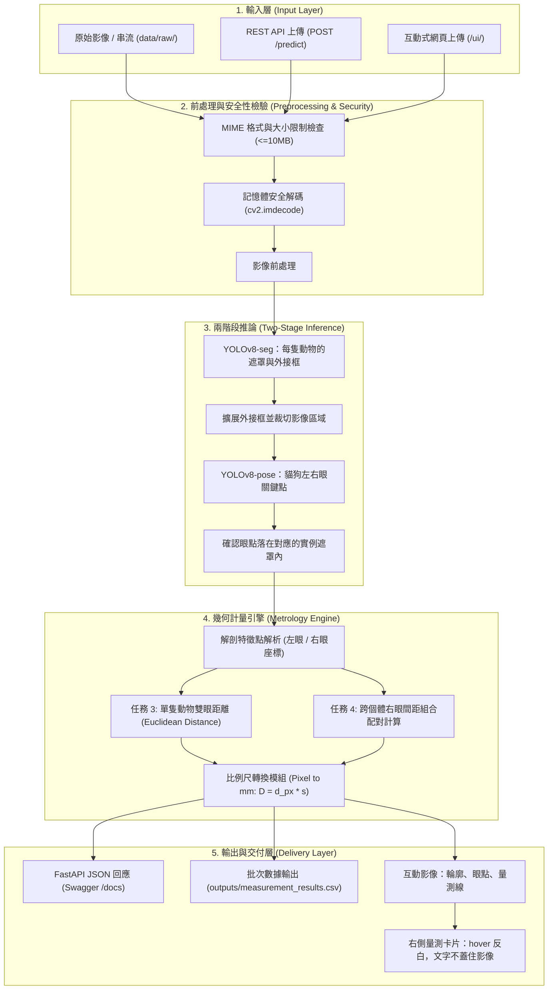
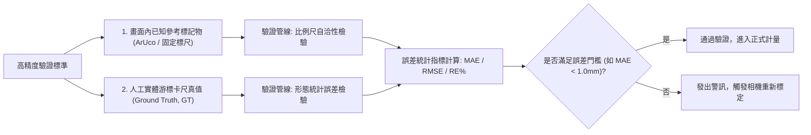

# 🐾 動物測量學電腦視覺系統 (Animal Metrology CV)

[](https://www.python.org/downloads/)
[](https://fastapi.tiangolo.com/)
[](https://github.com/ultralytics/ultralytics)
[](https://www.docker.com/)
---

## 專業測驗題目

本專案要處理的題目是將圖像分割（Image Segmentation）模型的輸出應用於實際測量學（Metrology）任務：

1. 使用 COCO 資料集，挑選至少包含兩隻動物的影像，動物種類不限。
2. 使用分割模型標示動物輪廓，並定位各動物的眼睛。
3. 量測每隻動物的雙眼距離。
4. 量測任意兩隻動物之間的右眼距離。
5. 說明使用的 AI 模型、選用原因及評估指標公式。
6. 說明量測方法、計算公式與驗證方式。

**實作範圍提醒：**本專案以實例分割遮罩呈現動物輪廓，並以姿態關鍵點定位貓狗眼睛（不是眼睛區域分割）。目前 CSV 範例使用的 `2ats.jpg` 不是 COCO 影像，因此不能視為已完成 COCO 多動物案例驗證；資料與模型適用範圍詳見下文。

## 📖 專案簡介 (Introduction)

**`animal-metrology-cv`** 是一套用於動物影像分析與形態距離計算的電腦視覺測量系統。

流程分成兩個模型階段：**YOLOv8-seg** 先取得每隻動物的實例遮罩與外接框；再將外接框向外擴展後，交給微調過的 **YOLOv8-pose** 只偵測貓狗的左右眼。姿態模型結果會再受該動物的分割遮罩約束；點位不在遮罩內就不採用。最後依既有比例尺計算像素距離與毫米距離。

- **任務 3 (Task 3)**：單隻動物個體之**雙眼距離 (Interocular Distance)** 計算（像素轉實體毫米 mm）。
- **任務 4 (Task 4)**：畫面中任意兩隻動物間**右眼至右眼跨個體距離 (Cross-Individual Right-Eye Distance)** 計算。
- **數據管線與輸出**：提供即時 RESTful API 服務與結構化 CSV 批次報告輸出。
- **互動式前端**：使用者可上傳照片；滑過輪廓或量測線時，右側量測卡片會反白，文字不覆蓋影像。

此版本的輪廓模型使用 COCO 預訓練權重；眼睛關鍵點模型只對貓、狗提供左右眼定位。眼睛是關鍵點，不是眼睛區域分割遮罩。`2ats.jpg` 範例用來展示兩隻貓的流程；該照片不作為 COCO 來源圖片，也不納入公開套件。

---

## 🏗️ 系統架構圖 (System Architecture)



獨立架構圖來源：[`docs/system_architecture.mmd`](docs/system_architecture.mmd)。

姿態模型只對分割出的貓、狗個體執行；其他 COCO 動物類別仍會保留輪廓，但不會產生眼點。缺少有效遮罩、模型沒有對應個體，或眼點不在該個體遮罩內時，系統不會以暗點等方式補猜眼睛。

---

## 🧰 技術棧說明 (Tech Stack)

| 領域 | 核心技術 / 套件 | 說明與用途 |
| :--- | :--- | :--- |
| **深度學習核心** | `ultralytics (YOLOv8-Seg + fine-tuned YOLOv8-Pose)` | 分割模型輸出動物遮罩；兩關鍵點姿態模型在擴展裁切區域偵測貓狗左右眼 |
| **影像處理** | `opencv-python`, `numpy` | 矩陣運算、幾何變換、畸變矯正、遮罩面積與視覺化標註繪製 |
| **後端服務** | `FastAPI`, `uvicorn[standard]` | REST API、靜態前端、OpenAPI / Swagger 文件 |
| **互動前端** | HTML, CSS, JavaScript Canvas | 照片上傳、輪廓/線段 hover 與右側量測卡片聯動 |
| **數據處理與輸出** | `pandas`, `pycocotools` | 形態測量數據整理、統計分析、COCO 評估格式與 CSV 匯出 |
| **容器化部屬** | `Docker` (Python 3.10-slim) | 隔離相依環境，滿足最小權限非 root 運行與資安合規 |

## 資料來源與適用範圍

- 動物實例分割使用 COCO 預訓練的 `yolov8n-seg.pt`，可分割其 COCO 類別中的多種動物。
- 左右眼模型從 `yolov8n-pose.pt` 起始，以 Animal-Pose 的 400 張貓狗影像重新訓練；分類各 200 張，缺失眼點以不可見關鍵點處理。
- 因此，目前只有貓與狗會產生眼點及距離；其他動物可以有分割輪廓，但不會有眼睛量測。
- `2ats.jpg` 是本機示範影像，不是 COCO 樣本；原始影像和訓練資料未放入套件。請使用具合法使用權的資料。

---

## 📁 專案目錄結構 (Directory Structure)

```text
animal-metrology-cv/
├── data/
│   ├── raw/                  # 本機原始影像（不隨套件或 GitHub 發布）
│   └── animalpose_eye_yolo/  # 本機訓練資料（來源影像不隨套件發布）
├── docs/
│   └── system_architecture.mmd
├── examples/
│   └── sample_measurements.csv
├── web/
│   ├── index.html            # 互動式照片上傳與量測頁面
│   ├── app.js
│   └── styles.css
├── src/
│   ├── metrology.py          # 分割、眼點驗證與距離計算
│   ├── api.py                # FastAPI、/ui/ 與預測端點
│   ├── visualize.py          # CLI 單張/資料夾推論
│   └── fetch_coco_samples.py # COCO 範例資料下載工具
├── tests/
│   ├── test_metrology.py
│   └── test_api_security_headers.py
├── models/                   # 本機模型權重（不隨套件或 GitHub 發布）
├── .env.example              # 系統環境變數範本
├── .gitignore
├── .dockerignore
├── Dockerfile                # 輕量安全容器建置腳本
├── requirements.txt          # 專案相依 Python 套件清單
└── README.md                 # 使用、API、模型與量測說明
```

---

## 🚀 本地運行步驟 (Local Setup & Run)

### 步驟 1：建立並啟用虛擬環境

```bash
cd animal-metrology-cv

# 建立 Python 3.10 虛擬環境
python3 -m venv venv

# 啟用虛擬環境 (Linux / macOS)
source venv/bin/activate
# (Windows 請執行: venv\Scripts\activate)
```

### 步驟 2：安裝相依套件

```bash
pip install --upgrade pip
pip install -r requirements.txt
```

### 步驟 3：設定環境變數

```bash
cp .env.example .env
mkdir -p models
cp /path/to/yolov8n-seg.pt models/yolov8n-seg.pt
cp /path/to/animal_eye_pose.pt models/animal_eye_pose.pt
```

提供的原始碼 ZIP 不包含模型權重、原始照片、訓練資料、推論輸出或 `.env`。因此不會打包舊的 100 張資料 checkpoint；目前 400 張資料訓練出的 checkpoint 也不包含在 ZIP 中，避免未確認模型與訓練資料授權前代為再散布。啟動推論前，請自行提供 YOLOv8-seg 的 `yolov8n-seg.pt` 與相容的兩關鍵點貓狗 Pose 權重，放入 `models/` 並確認其來源授權。`.env.example` 已設定對應路徑。

### 步驟 4：啟動互動式前端與推論

```bash
uvicorn src.api:app --host 127.0.0.1 --port 8000
```

- 開啟互動前端：`http://127.0.0.1:8000/ui/`
- Swagger API 文件：`http://127.0.0.1:8000/docs`
- ReDoc API 文件：`http://127.0.0.1:8000/redoc`

使用者可在前端選擇照片、調整比例尺後按「開始偵測」。也可以用 CLI 對單張或整個資料夾推論：

```bash
python src/visualize.py \
  --image data/raw/only_cats_dogs/2ats.jpg \
  --output-dir outputs/annotated/demo --device 0

python src/visualize.py \
  --input-dir data/raw/only_cats_dogs \
  --output-dir outputs/annotated/seg_pose_400 --device 0
```

測試：

```bash
python -m unittest discover -s tests -v
```

---

## 🐳 Docker 部署指令 (Docker Deployment)

容器以非 root 使用者執行。模型權重需放在本機 `models/`，並以唯讀掛載提供給容器。

### 1. 建置 Docker 映像檔

```bash
docker build -t animal-metrology-cv:1.0.0 .
```

### 2. 啟動 Docker 容器

```bash
docker run -d \
  --name metrology-service \
  -p 127.0.0.1:8000:8000 \
  --env-file .env \
  -v "$PWD/models:/models:ro" \
  -e SEG_MODEL_WEIGHTS_PATH=/models/yolov8n-seg.pt \
  -e POSE_MODEL_WEIGHTS_PATH=/models/animal_eye_pose.pt \
  -e DEVICE=cpu \
  --restart unless-stopped \
  animal-metrology-cv:1.0.0
```

### 3. 查看容器日誌與狀態

```bash
docker logs -f metrology-service
curl -f http://127.0.0.1:8000/health
```

互動介面為 `http://127.0.0.1:8000/ui/`。預設使用 CPU；若要在 Docker 中使用 GPU，需另外安裝 NVIDIA Container Toolkit，並以支援 CUDA 的 PyTorch 映像與相依套件設定。

---

## 🔌 API 文件與測試資訊 (API Documentation & Testing)

啟動 API 後可使用以下頁面：

- 互動前端：`http://127.0.0.1:8000/ui/`
- Swagger / OpenAPI：`http://127.0.0.1:8000/docs`
- ReDoc：`http://127.0.0.1:8000/redoc`

### 測試帳號與金鑰資訊

本專案沒有使用者名稱或密碼帳號。開發測試可不帶 API key；如請求帶有 `X-API-Key`，其值必須符合執行環境中的 `API_KEY`。`.env.example` 的值只供本機示範，不可作為正式環境金鑰。此 API 目前允許未帶 key 的請求，請勿未加存取控制就公開部署。

### 端點清單

| 方法 | 端點 | 說明 |
| :--- | :--- | :--- |
| `GET` | `/ui/` | 互動式上傳、輪廓與距離 hover 檢視 |
| `GET` | `/health` | 健康檢查，確認 YOLO 模型載入狀態與當前比例尺 |
| `GET` | `/docs` | Swagger UI 互動式測試介面 |
| `POST` | `/predict` | 上傳動物圖片並以 JSON 回傳偵測結果、眼睛座標與測量數值 |
| `POST` | `/predict/visualize` | 回傳靜態標註 JPEG；互動效果請使用 `/ui/` |

若要直接在 Swagger 的 Response body 查看偵測結果，請在 `/docs` 展開 **POST `/predict`**、上傳圖片並執行。`/predict/visualize` 的回應是 JPEG 圖片；這個端點不會在 Response body 顯示 JSON 數值。

### cURL 呼叫範例

```bash
curl -X POST "http://127.0.0.1:8000/predict?pixel_to_mm_scale=0.15&save_to_csv=false" \
  -H "accept: application/json" \
  -H "Content-Type: multipart/form-data" \
  -F "file=@data/raw/only_cats_dogs/2ats.jpg"
```
上述影像路徑是本機示例；公開程式套件不附照片，請改用具有合法使用權的圖片。

### `2ats.jpg` 測量範例

使用最新貓狗 Pose 權重與 `0.15 mm/px` 範例比例尺，模型在這張影像偵測到兩隻貓：

| 測量項目 | 範例結果 |
| :--- | ---: |
| animal_1 雙眼距離 | 4.608 mm |
| animal_2 雙眼距離 | 4.519 mm |
| 兩隻動物右眼至右眼距離 | 42.411 mm |

完整 CSV 範例位於 [`examples/sample_measurements.csv`](examples/sample_measurements.csv)。這些是模型預測值；`0.15 mm/px` 只是目前示範設定，並未用 2ats 照片中的實體標尺校正，不能視為具校正追溯性的實際物理尺寸。

CSV 只記錄影像參照路徑與量測數值，不內嵌或附帶任何照片。這筆 `2ats.jpg` 是本機使用者提供的示範影像，**不是 COCO 影像**；它用來展示雙動物的眼距和跨個體右眼距離，不可當作「COCO 多動物照片」的驗證證據。請勿把同名本機照片加入公開套件。

### COCO 資料集範圍與限制

- 專案的 YOLOv8-seg 使用 COCO 預訓練權重；本機 `data/raw/` 中曾有多隻馬、斑馬、長頸鹿與大象等 COCO 樣本。原始影像不包含在程式碼 ZIP 中。
- 眼睛模型是使用 Animal-Pose 貓狗資料微調的兩點 YOLOv8-Pose；目前只支援貓、狗。因此，非貓狗 COCO 影像可做動物輪廓分割，但不會產生眼點或眼距。
- 本次可交付的 CSV 範例是使用者提供的雙貓影像，而不是 COCO。由於未將一張可合法再散布、且包含至少兩隻貓狗的 COCO 影像及其推論結果納入套件，本專案目前**不能聲稱已用該 CSV 完成 COCO 多動物眼距驗證**。對外報告時應明確區分 COCO segmentation 預訓練來源、Animal-Pose 關鍵點訓練資料，以及本機 demo 量測樣本。

---

## 🔬 核心申論題詳述 (Core Theoretical Analyses)

---

### 📝 第 5 題：YOLOv8-Pose / YOLOv8-Seg 模型選型理由與數學評估指標詳解

#### 1. 選擇 YOLOv8-Pose / YOLOv8-Seg 的核心原因

在動物形態計量學 (Animal Metrology) 的落地場景中，選擇基於 Ultralytics 的 YOLOv8-Pose / Seg 架構，主要基於以下四大工程與演算法優勢：

1. **分階段模型各司其職 (Segmentation + Cropped Pose)**：
   - 第一階段的 YOLOv8-seg 負責個體遮罩與外接框；第二階段將外接框擴展後，送入獨立的 YOLOv8-pose 貓狗眼睛模型。兩個模型分開推論，眼點還會用個體遮罩做範圍驗證。
   - 這樣可以讓姿態模型專注於每隻動物的局部畫面；代價是每個貓狗個體都要額外執行一次姿態推論，整體速度取決於影像中的個體數量與硬體。
2. **免從頭訓練與強大的遷移學習能力 (Transfer Learning & Pre-trained Priors)**：
   - 特殊動物（如特定品種牛隻、羊隻、瀕危物種）的解剖影像標註極為昂貴且困難，難以收集數十萬張影像從零訓練 (From Scratch)。
   - 本專案使用 COCO 預訓練的 `yolov8n-pose.pt` 作為起點，將姿態輸出調整為兩個眼睛關鍵點，再用標註的貓狗圖片微調。少量資料適合做初步實驗，實際泛化能力仍須以獨立測試集和使用者影像評估。
3. **Anchor-Free 設計與尺度適應性**：
   - 動物在攝像鏡頭前的姿態多變（站立、俯臥、側身）、體型大小跨度極大。YOLOv8 捨棄傳統複雜且僵硬的 Anchor Boxes，改採無錨點 (Anchor-Free) 迴歸中心點與關鍵點偏移，顯著減低對超參數預設的敏感度，改善關鍵點定位精度。

---

#### 2. 模型評估指標之數學公式推導

評估動物關鍵點檢測與實例分割的表現，業界標準採用 **OKS (Object Keypoint Similarity)** 與基於其建構的 **mAP (Mean Average Precision)**。

##### (A) 物件關鍵點相似度 (Object Keypoint Similarity, OKS)

OKS 衡量預測的解剖關鍵點與標註真值 (Ground Truth, GT) 之間的相似程度，其數學形式類似於目標檢測中的 IoU，值域落在 $[0, 1]$：

$$OKS = \frac{\sum_{i} \exp\left(-\frac{d_i^2}{2 s^2 \sigma_i^2}\right) \delta(v_i > 0)}{\sum_i \delta(v_i > 0)}$$

**參數幾何與物理意涵解析：**
- $d_i = \sqrt{(x_i - \hat{x}_i)^2 + (y_i - \hat{y}_i)^2}$：第 $i$ 個關鍵點之**預測座標 $(\hat{x}_i, \hat{y}_i)$ 與真值座標 $(x_i, y_i)$ 間的歐幾里得像素距離**。
- $s$：目標動物個體的**尺度因子 (Scale Factor)**，定義為個體分割面積或邊界框面積的平方根：$s = \sqrt{\text{Area}}$。
  - *意義*：引入 $s$ 能確保尺度不變性。對於遠處較小個體，較小的像素偏移量就會被嚴格扣分；反之對於近處較大個體，允許等比例較寬容的絕對像素偏差。
- $\sigma_i$：第 $i$ 個關鍵點的**歸一化標準差因子 (Keypoint Per-class Falloff Constant)**。
  - *意義*：不同解剖部位的標註不確定性不同。例如動物「眼睛 (Eye)」特徵清晰，人工標註變異極小，故設定較小的 $\sigma \approx 0.025$（稍有偏差即迅速衰減懲罰）；而對於「肩關節」或「臀部」，解剖定義較模糊，標註誤差自然較大，$\sigma \approx 0.089$。
- $v_i$：關鍵點真值可見度標籤（$v_i = 0$ 為未標註，$v_i = 1$ 為存在但被遮擋，$v_i = 2$ 為清晰可見）。
- $\delta(v_i > 0)$：狄拉克指示函數 (Kronecker Indicator)，僅針對影像中實際存在的關鍵點進行計算。

##### (B) 平均精確率 (Mean Average Precision, mAP)

在特定 OKS 門檻 $T$（如 $T = 0.5$ 或 $T = 0.75$）下，若某檢測結果滿足 $OKS \ge T$，則將該預測判定為 True Positive (TP)，否則為 False Positive (FP)。

1. **精確率 (Precision, $P$) 與召回率 (Recall, $R$)**：
   $$P(t) = \frac{TP(t)}{TP(t) + FP(t)}, \quad R(t) = \frac{TP(t)}{TP(t) + FN(t)}$$

2. **單一類別平均精確率 (Average Precision, AP)**：
   透過計算 Precision-Recall 曲線下的面積進行數值積分（通常採用 101 點插值法）：
   $$AP = \int_0^1 P_{\text{interp}}(r) \, dr$$
   其中 $P_{\text{interp}}(r) = \max_{\tilde{r} \ge r} P(\tilde{r})$。

3. **全類別平均精確率 (mAP)**：
   對所有目標類別集合 $C$ 取期望值：
   $$mAP = \frac{1}{|C|} \sum_{c \in C} AP_c$$

4. **綜合評估指標 $mAP@[0.5:0.95]$**：
   在 OKS 門檻由 0.50 遞增至 0.95（步長 0.05，共 10 個門檻階梯）下分別計算 mAP 並取平均值，代表模型在嚴苛幾何約束下的整體穩健度。

##### 本版本的保留測試集結果

最新貓狗 Pose 權重以 400 張資料重新切分（320 train、40 validation、40 test；每類測試 20 張）。保留測試集的 Pose `mAP50 = 0.963`、`mAP50-95 = 0.911`。測試集很小，這些指標只衡量關鍵點檢出，不代表像素級誤差或實體毫米量測的校正精度。

---

### 📏 第 6 題：歐幾里得距離、物理比例尺轉換邏輯與交叉驗證機制詳解

#### 1. 歐幾里得距離公式 (Euclidean Distance)

在 2D 數位影像平面上，任兩組解剖關鍵點座標 $P_1(x_1, y_1)$ 與 $P_2(x_2, y_2)$ 之空間幾何直線距離定義如下：

$$d_{\text{pixel}} = \sqrt{(x_2 - x_1)^2 + (y_2 - y_1)^2}$$

##### 任務 3：單隻動物個體之雙眼距離 (Interocular Distance)
設單隻動物個體經關鍵點檢測所得之左眼中心座標為 $P_{\text{left}}(x_L, y_L)$，右眼中心座標為 $P_{\text{right}}(x_R, y_R)$，則個體眼距為：
$$d_{\text{intra\_eye, px}} = \sqrt{(x_R - x_L)^2 + (y_R - y_L)^2}$$

##### 任務 4：任意兩隻動物間右眼至右眼跨個體距離 (Inter-Animal Distance)
設個體 $A$ 的右眼中心為 $P_{A\_R}(x_{A\_R}, y_{A\_R})$，個體 $B$ 的右眼中心為 $P_{B\_R}(x_{B\_R}, y_{B\_R})$，兩者右眼間的跨個體距離為：
$$d_{\text{inter\_eye, px}} = \sqrt{(x_{B\_R} - x_{A\_R})^2 + (y_{B\_R} - y_{A\_R})^2}$$

---

#### 2. 像素轉物理單位 (mm) 的比例尺轉換邏輯

影像中的距離單位為**像素 (Pixel)**，欲將其映射至實體物理世界之**毫米 (Millimeter, mm)**，其轉換架構與數學關係如下：

##### (A) 線性比例轉換模型
定義比例轉換係數 $s$（單位：$\text{mm/pixel}$）：

$$s = \frac{D_{\text{known, mm}}}{d_{\text{known, px}}}$$

任何由演算法測得之像素距離 $d_{\text{pixel}}$，其對應的物理真值換算公式為：

$$D_{\text{physical, mm}} = d_{\text{pixel}} \times s$$

##### (B) 光學成像模型與幾何物理條件
針孔相機模型 (Pinhole Camera Model) 表明：

$$d_{\text{px}} = f \cdot \frac{D_{\text{real}}}{Z}$$

其中 $f$ 為鏡頭焦距 (以像素計)，$Z$ 為物體距離感測平面的工作深度 (Depth)。比例尺 $s = \frac{Z}{f}$ 之有效性需依賴以下關鍵工程前提：
1. **共面假設 (Coplanar Assumption)**：
   - 測量目標（動物解剖點）與基準參考物必須位於同一景深平面 ($Z_{\text{target}} \approx Z_{\text{reference}}$)。
   - 若深度產生顯著落差 $\Delta Z$，透視縮放效應將導致尺寸估算產生 $\frac{\Delta Z}{Z}$ 的線性系統誤差。
2. **鏡頭畸變校正 (Lens Distortion Correction)**：
   - 廣角或普通定焦鏡頭邊緣存在徑向畸變 (Radial Distortion, $k_1, k_2$) 與切向畸變 (Tangential Distortion, $p_1, p_2$)。
   - 在執行像素測距前，系統必須利用標定棋盤格預先獲取相機內參矩陣 $\mathbf{K}$，並呼叫 `cv2.undistort` 將畸變像素點映射回無失真的理想針孔幾何平面。
3. **已知基準物校正 (Fiducial Marker Calibration)**：
   - 在牧場圍欄、量測地磅或動物標籤處固定標定板（例如 ArUco Marker、AprilTag 或已知寬度的標準色卡）。
   - 演算法即時偵測標記四角點並計算其像素寬度 $d_{\text{marker, px}}$，自動刷新當前畫面的動態比例尺 $s$。

---

#### 3. 交叉驗證機制 (Cross-Validation against Ground Truth & Known Markers)

為了確認測量系統的準確度、穩定性與工程可信度，建議採用**兩級交叉驗證流程**。目前專案沒有相機標定板自動偵測或游標卡尺真值資料；以下是部署前的驗證方法，不是已完成的實體量測驗證：



##### (A) 核心誤差評估數學指標

設測試樣本集共包含 $N$ 組比對樣本，$D_{\text{pred}}^{(k)}$ 為系統測得之毫米距離，$D_{\text{gt}}^{(k)}$ 為高精度游標卡尺測得之真值：

1. **平均絕對誤差 (Mean Absolute Error, MAE)**：
   衡量系統整體平均偏差大小：
   $$MAE = \frac{1}{N} \sum_{k=1}^N \left| D_{\text{pred}}^{(k)} - D_{\text{gt}}^{(k)} \right|$$

2. **均方根誤差 (Root Mean Square Error, RMSE)**：
   對大誤差極度敏感，用以檢驗系統是否存在重大離群偏差：
   $$RMSE = \sqrt{\frac{1}{N} \sum_{k=1}^N \left( D_{\text{pred}}^{(k)} - D_{\text{gt}}^{(k)} \right)^2}$$

3. **相對誤差百分比 (Relative Error, RE%)**：
   衡量相對於量測目標尺度的相對準確度：
   $$RE\% = \frac{1}{N} \sum_{k=1}^N \left( \frac{\left| D_{\text{pred}}^{(k)} - D_{\text{gt}}^{(k)} \right|}{D_{\text{gt}}^{(k)}} \times 100\% \right)$$

##### (B) 兩級交叉驗證執行架構
1. **第一級：場景標記自洽驗證 (Online In-frame Marker Self-Audit)**：
   - 影像中同時擺放兩組不同位置的已知標記物（標記 A 用於計算比例尺，標記 B 用於閉環驗證）。
   - 若由標記 A 算出的比例尺估算標記 B 之實體尺寸誤差大於 $1.5\%$，系統立即發出相機角度偏斜或景深不一致的警訊。
2. **第二級：人機盲測交叉審查 (Offline Caliper Cross-Audit)**：
   - 由專業獸醫師或品管員以高精度游標卡尺隨機抽檢 $N \ge 30$ 隻動物標本之實測雙眼距離 $D_{\text{gt}}$。
   - 計算本系統輸出值與手動實測值之 MAE 與 RMSE。當系統滿足 $MAE \le 1.0\,\text{mm}$ 且 $RE\% \le 2.0\%$ 時，確認系統通過驗證標準。

---

## 上傳至 GitHub

解壓 ZIP 後，在專案資料夾執行以下指令；先檢查 `git status`，確認沒有要排除的本機檔案，再替換成自己的 GitHub repository URL：

```bash
git init -b main
git add .
git status
git commit -m "Initial animal metrology CV project"
git remote add origin https://github.com/<YOUR-USER>/<YOUR-REPOSITORY>.git
git push -u origin main
```

`.gitignore` 會排除 `.env`、照片、訓練資料、權重、推論輸出與 ZIP。此程式專案沒有指定開源授權；公開 repository 前請先決定授權，並確認模型與資料來源的再散布條款。

---

## 📄 授權條款 (License)

本專案程式碼尚未指定開源授權；未附 `LICENSE`，請勿假設可依 MIT 條款再散布。YOLO/Ultralytics 權重、COCO/Animal-Pose 資料及使用者提供的範例照片各自受其來源條款約束。公開發布前請逐項確認授權；原始照片、訓練資料、模型權重、推論輸出與 `.env` 不包含於原始碼 ZIP。
